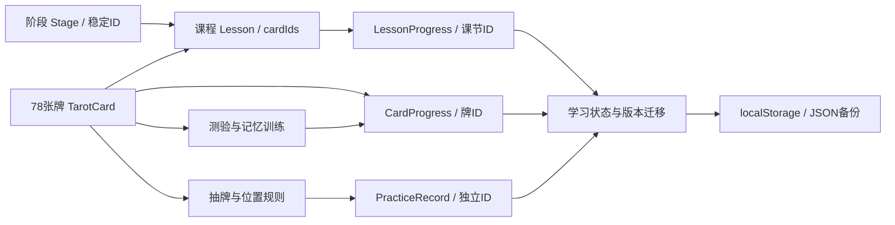

# 第一版的结构与七阶段扩展

本项目采用可独立修改的知识数据、课程数据、学习状态与练习记录。没有依赖标题或数组索引识别用户学过的内容。

- `Stage` 定义稳定ID与顺序；`Lesson` 挂在阶段下，内部含教学段落、关联牌、练习与示例。未来加阶段或加单元不改变既有课节ID。
- `CardProgress` 保存状态、收藏、个人笔记、作答统计与到期日；`LessonProgress` 保存练习文本、完成时间和更新时间。
- `PracticeRecord` 将牌义资料与一次实际练习区分开。每次保存问题、牌阵ID、逐张牌及位置和方向、原始解读、参考快照与复盘。可选 `lessonId` 能把案例练习挂回课程。
- `ReadingDraft` 独立保留未完成的解牌过程。保存到日记时用同一记录ID更新，避免重复创建记录。
- `learning.ts` 不依赖 React，可分别验证洗牌、判题数据、排期、日期和备份格式。`store.tsx` 集中管理学习动作与保存，页面不各自维护一套进度格式。

当前首页使用八步推荐路线；它是入门学习的顺序，不限制未来正式课程调整为七阶段体系。新增的牌义联系、进阶牌阵、综合解牌、案例实战和个人解牌体系，都以新课节ID加入；现有进度会继续对应原课节。若课程内容大幅更新，保留原ID或明确编写映射，不能随意重命名导致“学过的课消失”。

新增练习类型需要扩展 `PracticeKind`、该类型界面和导入校验，继续共用基本记录字段；不必把第一版每一种练习都拆成一个框架。复杂牌阵可以复用不重复抽牌逻辑，添加位置与布局。接入数据库时先替换存储实现，保持领域ID；账户、权限与冲突处理在引入同步时具体设计。

存储带有 `schemaVersion`，所有加载与导入经过 `migrateState()`。它保留合法的未知课节ID，拒绝损坏牌记录与非法日期；格式不兼容时保留原始数据并显示恢复入口。未来有破坏性变更时增加版本迁移，不清空旧存储。

本版有意采用明确的静态数据、纯函数和单一 React 状态入口。升级点已有实际的字段和读写边界，不预先创建尚无用途的账户、插件系统、数据库或AI服务。

## 本次核心教学升级

- 基础牌资料保留在 major.ts / minor.ts，详细教学单独保存在 deepMajor.ts 与四花色数据文件，统一由 deep.ts 索引。DeepTeaching 对视觉事实、象征解释、推理桥梁分别建字段，案例保留问题、背景、位置、正逆位、替代解释与行动。
- academy.ts 是入门知识与教学流程；questions.ts 仅负责纯规则诊断，不操作页面或存储。真实AI能力将来若引入，应替换这一明确边界，并准确标注能力来源。
- 教学进度使用可选的 LearningState.teaching。稳定练习键包含牌ID、牌位和方向；保存独立解读、已展开步骤、题目答案、复盘及关联日记ID。重复保存更新同一日记，删除过的日记再次保存会创建新ID。
- questionDraft 保存原始问题及修改版本；带入实验室的新问题先显示待应用提示。有实际抽牌时，只有用户明确确认新练习才替换草稿。
- schemaVersion仍为1，这是向后兼容的可选字段增加；migrateState为旧备份补默认值，校验新字段，保留已有记录和合法未知课程ID。以后有破坏性格式变化再增加版本并编写显式迁移。
- 旧27节课保留原ID，只调整推荐分组。原 foundations / minor-patterns 阶段链接仍映射到新的对应分组，避免旧链接失效。
